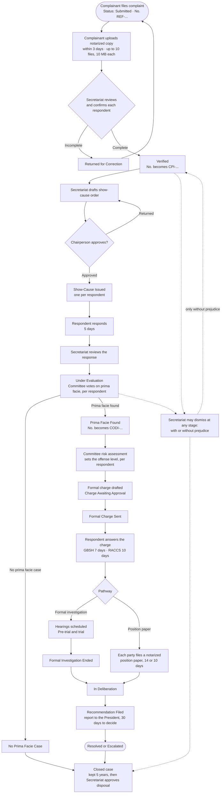

# CODI-IS process flow

The path of one case, from filing to a decision. Status names are the ones shown in the system.
Paste the diagram into https://mermaid.live to view or export it as an image.

## Who does what

| Step | Who |
|---|---|
| File the complaint and upload the notarized copy | Complainant (any university member) |
| Check the complaint, confirm each respondent, verify | CODI Secretariat |
| Approve the show-cause order | CODI Chairperson |
| Respond to the show-cause order and the formal charge | Respondent |
| Vote on prima facie, do the risk assessment | CODI Committee |
| Draft the charge, schedule hearings, record outcomes | CODI Secretariat |
| Decide on the recommendation | Disciplining Authority (President) |
| Dismiss, reopen, approve disposal of old records | CODI Secretariat |

## Deadlines running alongside

| Stage | GBSH Code (students) | RACCS 2025 (personnel) |
|---|---|---|
| Notarized complaint | 3 days | 3 days |
| Respondent's response | 5 days | 5 days |
| Report to the President | 30 days from the response | 5 days from the prima facie finding |
| Formal charge | 15 days | no fixed period |
| Answer to the charge | 7 days | 10 days |
| Position paper | 14 days | 10 days |
| Decision | 30 days | 30 days |

Reminders go out in the system and by email before each deadline, and the Secretariat is told when one passes.

## Case numbers

`REF` when filed, `CPI` when verified, `CODI` when a prima facie case is found.
